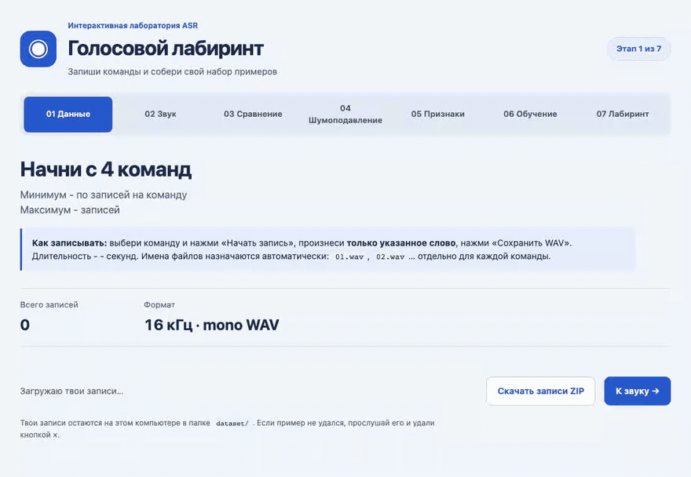

# «От звуковой волны к слову» - офлайн-мастер-класс

ASR Maze Lab — интерактивная лаборатория для знакомства с технологиями автоматического распознавания речи на примере
классификации коротких голосовых команд. Участники собирают речевой датасет, исследуют акустические признаки,
обучают k-NN-классификатор и используют его для голосового управления лабиринтом.

**[Открыть лабораторию → localhost:8000](http://localhost:8000/collect.html)** — после запуска сервера через `make server`.



## Формат мастер-класса

- Ведущий с базовыми навыками программирования запускает сервис на своем компьютере и выводит экран на доску.
- Ученики или студенты подходят записать голос и предлагают изменения признаков и параметров обучения.
- Данные и настройки общие для группы. Формат с отдельным компьютером у каждого участника пока не поддерживается.

## Что можно попробовать

1. **Данные** - записать команды «вверх», «вниз», «влево», «вправо».
2. **Звук** - увидеть волну, спектр и спектрограмму своей записи.
3. **Сравнение** - сопоставить разные слова и голоса на одинаковых шкалах.
4. **Шумоподавление** - убрать шум и тишину по краям, сравнить результат с исходником.
5. **Признаки** - менять мел-фильтры, MFCC, размер и шаг окна анализа.
6. **Обучение** - обучить k-NN, увидеть записи на графике и проверить новую команду.
7. **Лабиринт** - управлять роботом голосом или текстом.

## Быстрый старт

Нужны **Python 3.10+**, `make`, микрофон и браузер с поддержкой записи звука.
Интернет нужен для установки зависимостей; после подготовки лаборатория работает без сети.

1. В папке проекта подготовить окружение:

   ```bash
   make setup
   ```

2. Запустить сервер:

   ```bash
   make server
   ```

3. Открыть [сбор записей](http://localhost:8000/collect.html) и разрешить доступ к микрофону.
4. Записать по **5-50 примеров** каждой команды и пройти этапы через навигацию на страницах.

- **С кешем и сохранением моделей:** вместо `make server` использовать `make server-cache`.
- **Остановить сервер:** `Ctrl+C` в терминале запуска или `make down`.
- **Удалить все записи, модели и кеш:** после остановки сервера выполнить `make clean`. Удаление без подтверждения.

## Настройки и данные

- [config/lab.json](config/lab.json) задает лимит кеша, число и длительность записей, шкалы признаков и начальные параметры. [Описание конфига](docs/configuration.md).
- Настройки обработки и признаков сохраняются кнопкой **«Применить»**. Для обучения с измененными параметрами модель нужно обучить заново.
- WAV и модели хранятся локально в `dataset/` и `models/`, в Git не попадают. Датасет можно скачать через ZIP на странице сбора.

## Ограничения

- Модель различает только 4 команды и всегда выбирает одну из них, даже для постороннего слова.
- Результат зависит от голосов, микрофона, записей и параметров. Это учебный классификатор; подтвержденная точность на отдельной речевой выборке не проводилась.

## Разработка

[Команды, структура и проверки](docs/development.md) · [Оценка модели](docs/evaluation.md) · [Технические ограничения](docs/limitations.md)

<details>
<summary>Что учитывать при выполнении команд</summary>

- Запускайте команды из корня проекта: `make -f` из другой папки может затронуть ее файлы. Установка меняет `.venv`; `make setup-dev` также пересоздает `node_modules` и устанавливает Git-хук. Устанавливайте зависимости из доверенных источников.
- Перед сменой режима и очисткой остановите сервер. `make clean` без подтверждения удаляет записи, модели, настройки, отчеты и кеши, сохраняя `.gitkeep`, исходники и зависимости. Нужные WAV сохраните через ZIP; работающий сервер может создать кеш и настройки заново.
- `make down` проверяет каталог и команду запуска процесса на порту 8000; нужны `lsof`, `ps`, `sed`. Незавершенные операции прерываются. Проверка и сигнал неатомарны: остается редкий риск повторного использования PID. Сервер с другой командой запуска останавливайте через `Ctrl+C`.
- Оба режима используют общие данные. Изменение датасета сбрасывает кеш и историю моделей режима предрасчета. `make format` изменяет файлы; проверяйте diff.
- `make evaluate` создает JSON, а `--overwrite` перезаписывает указанный файл. Сохраняйте отчеты в `reports/`: при прерывании JSON может остаться неполным. `ARGS` выполняется через оболочку, поэтому не передавайте чужой непроверенный текст.
- Команды проверок не исправляют исходники, но могут создавать кеши. Поиск секретов не проверяет всю историю Git и не гарантирует обнаружение всех чувствительных данных.

</details>

Разработка велась с GPT-6.1 Sol.

Лицензия - [MIT](LICENSE).
